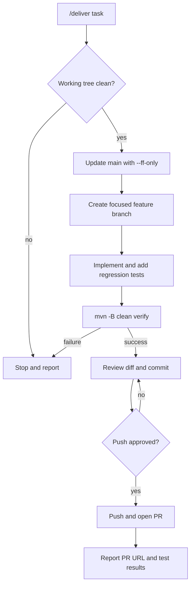

# MilkyRoutes - Engineering Guidelines

## Project
Modernize MilkyRoutes while preserving and improving its
original algorithms and data structures.

## Code Standards
- Target Java 21 through a dedicated migration.
- Write code comments and documentation in English.
- Use clear, concise names and established Java conventions.
- Comment important decisions, not obvious operations.
- Preserve existing contracts unless changes are justified.
- Keep the optimization engine independent of AI frameworks.
- Prefer simple solutions over unnecessary abstractions.

## Git Workflow
- Work in focused feature/* branches.
- Never commit directly to main.
- Keep commits small, atomic, and descriptive.
- Use concise English commit messages.
- Separate bug fixes, refactoring, and new features.
- Review the diff before committing.

## Development Automation
- GitHub Actions CI (`.github/workflows/ci.yml`) runs `mvn -B clean verify` on
  every pull request and push to main, with JDK 21 (Temurin), Maven dependency
  caching, and headless mode (`JAVA_TOOL_OPTIONS=-Djava.awt.headless=true`).
- Run the same verification locally before pushing:
  `JAVA_HOME=<JDK 21 path> JAVA_TOOL_OPTIONS=-Djava.awt.headless=true mvn -B clean verify`.
- `/deliver <task>` (`.opencode/commands/deliver.md`, OpenCode V2) runs the
  delivery loop below in the Build agent.

- Automation safety rules: never commit directly to main; never force-push,
  reset, clean, or delete branches; never merge PRs automatically; stop when
  validation fails; only report verified results.

## Quality
- Preserve existing behavior during pure refactoring.
- Add regression tests for every bug fix.
- Run compilation and relevant tests before opening a PR.
- Never weaken tests to achieve a successful build.
- Document existing failures and technical limitations.
- Do not claim successful validation without execution.

## AI Agents
- Inspect existing implementations before proposing changes.
- Explain the approach briefly before complex modifications.
- Make minimal, focused changes.
- Reuse existing APIs and components where appropriate.
- Never replace custom algorithms with external solvers.
- Require approval for destructive operations.
- Never expose secrets or commit credentials.

## Pull Requests
Keep descriptions concise and in English:
- Summary
- Changes
- Testing
- Risks

## Documentation
- Keep README.md accurate and concise.
- Document architecture and important design decisions.
- Use Mermaid diagrams for relevant technical workflows.
- Avoid unsupported claims about implemented features.
